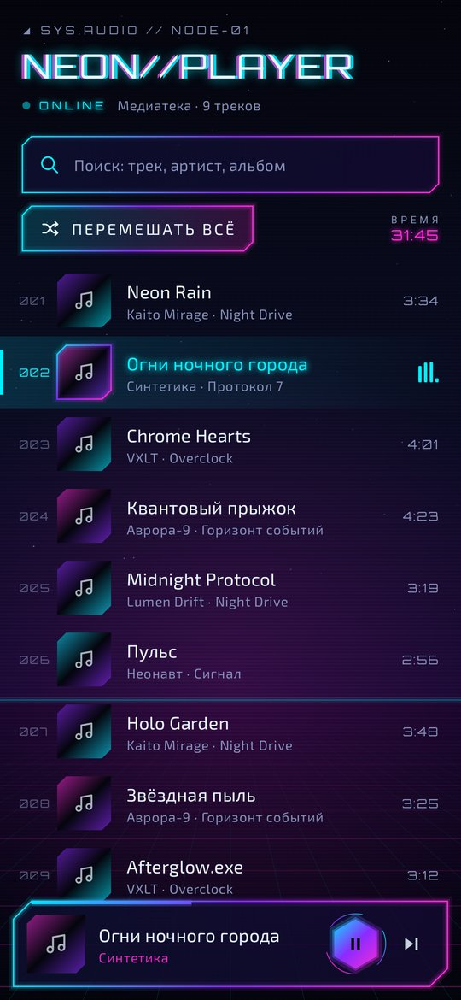
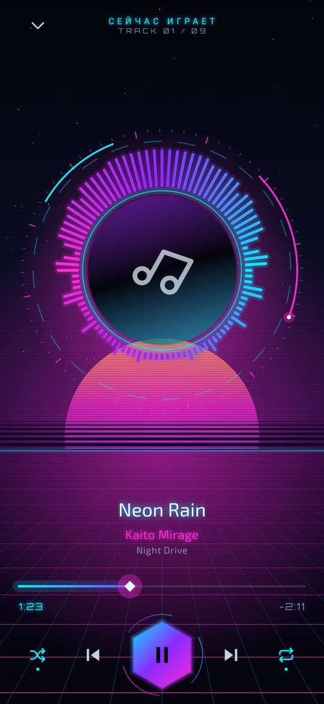
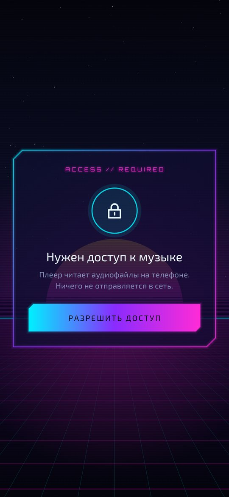

# Neon Player

Музыкальный плеер для Android в неоновом стиле synthwave/киберпанк. Играет музыку, которая уже лежит на телефоне.

<p>
  
  
  
</p>

## Что умеет

- **Медиатека**: все треки с устройства, поиск по названию, артисту и альбому, «Перемешать всё», общее время.
- **Экран «Сейчас играет»** с «реактором»: обложка крутится как пластинка внутри кольца из 96 столбиков спектра, вокруг вращаются HUD-кольца.
- **Настоящий визуализатор**: спектр считается из того же звука, который играет плеер (БПФ на 1024 отсчёта, 48 логарифмических полос). Разрешение на микрофон не нужно.
- **Фон** — сетка synthwave, уходящая к горизонту, полосатое солнце, мерцающие звёзды и CRT-развёртка. Свечение пульсирует в такт басу.
- **Фоновое воспроизведение**: уведомление, кнопки на экране блокировки, наушники и Bluetooth, пауза при отключении наушников.
- Перемешивание, повтор (все / один), перемотка с неоновым ползунком, мини-плеер.

## Как установить на телефон

**Готовый APK.** Каждая сборка в GitHub Actions (workflow «Neon Player APK») выкладывает артефакт `neon-player-debug-apk`. Скачайте архив, распакуйте `app-debug.apk`, перекиньте на телефон и откройте. Android попросит разрешить установку из этого источника.

**Через Android Studio.** Откройте папку `apps/neon-player` и нажмите Run.

**Из командной строки** (нужен Android SDK):

```bash
cd apps/neon-player
./gradlew :app:assembleDebug          # APK: app/build/outputs/apk/debug/app-debug.apk
adb install app/build/outputs/apk/debug/app-debug.apk
```

Требования: Android 8.0 (API 26) и новее.

## Устройство проекта

| Файл | Что делает |
|------|------------|
| `PlaybackService.kt` | Media3 `MediaSessionService` с ExoPlayer; в аудиоцепочку вставлен `TeeAudioProcessor`, который отдаёт PCM анализатору |
| `audio/SpectrumMath.kt` | Окно Ханна, БПФ, раскладка по логарифмическим полосам в дБ (покрыто юнит-тестами) |
| `audio/SpectrumAnalyzer.kt` | Собирает PCM в кадры и публикует полосы через `StateFlow` |
| `data/MusicRepository.kt` | Читает треки из MediaStore |
| `PlayerViewModel.kt` | `MediaController`, очередь, состояние воспроизведения |
| `ui/components/` | Фон, реактор, ползунок, гексагональная кнопка, неоновые рамки, glitch-логотип |
| `ui/screens/` | Медиатека, «Сейчас играет», запрос доступа |

Стек: Kotlin, Jetpack Compose, Media3 (ExoPlayer + MediaSession), Coil. Иконки нарисованы векторами прямо в коде (`NeonIcons.kt`).

## Тесты и скриншоты

```bash
./gradlew :app:testDebugUnitTest                # юнит-тесты
./gradlew :app:testDebugUnitTest -Pscreenshots  # отрисовать экраны в app/screenshots/ (Robolectric + Roborazzi)
```

## Шрифты

[Orbitron](https://github.com/theleagueof/orbitron) и [Exo 2](https://github.com/googlefonts/Exo-2.0), лицензия SIL Open Font License 1.1 (см. `fonts-license/`).
